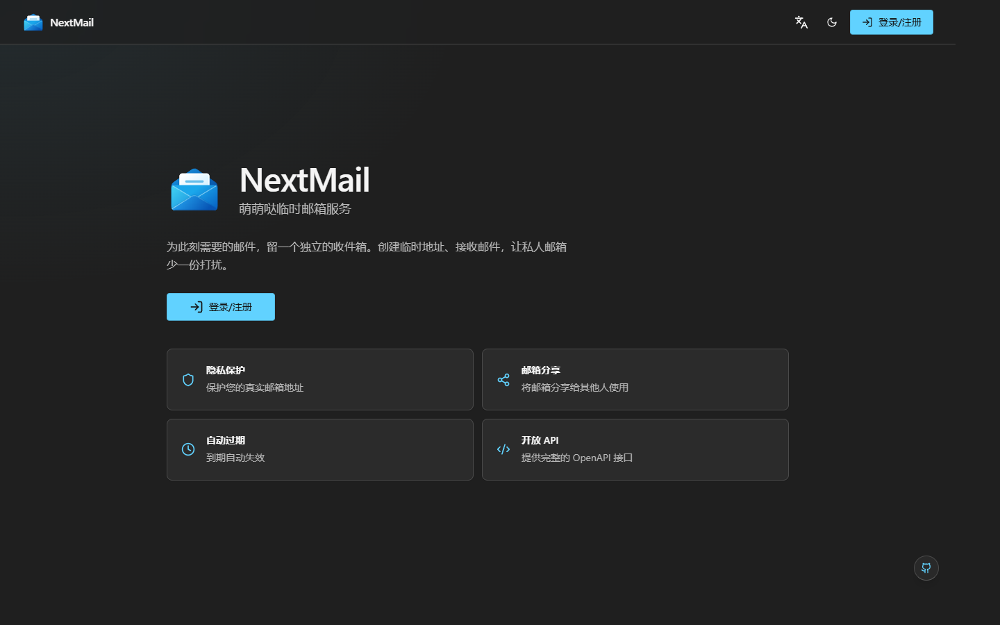

  
  <h1 align="center">NextMail</h1>

## 使用文档
**原 NextMail 仓库完整文档**: [https://docs.moemail.app](https://docs.moemail.app)

当前仓库文档：[使用](docs/usage.md) | [开发](docs/develop.md) | [部署](docs/deploy.md) | [审查](docs/review.md)

## 预览

在线体验：[nextmail.pages.dev](https://nextmail.pages.dev/zh-CN)

## 特性

- 🔒 **隐私保护**：保护您的真实邮箱地址，远离垃圾邮件和不必要的订阅
- ⚡ **实时收件**：自动轮询，即时接收邮件通知
- ⏱️ **灵活有效期**：支持 1 小时、24 小时、3 天或永久有效
- 🎨 **主题切换**：支持亮色和暗色模式
- 📱 **响应式设计**：完美适配桌面和移动设备
- 🔄 **自动清理**：自动清理过期的邮箱和邮件
- 📱 **PWA 支持**：支持 PWA 安装
- ☁️ **Cloudflare 自部署**：用户名密码认证可能需要 Workers Paid 方案，详见[部署要求](docs/deploy.md#runtime-requirements)；只使用 OAuth 登录则可忽略。
- 🎉 **简雅的 UI**：重构后的基于 WinUI3 Fluent Design 设计理念的界面，尽量支持移动端
- 📤 **发件功能**：支持使用临时邮箱发送邮件，基于 Resend 服务
- 🔔 **Webhook 通知**：支持通过 webhook 接收新邮件通知
- 🛡️ **权限系统**：支持基于角色的权限控制系统
- 🔑 **OpenAPI**：支持通过 API Key 访问 OpenAPI
- 🌍 **多语言支持**：支持英文、简体中文，可自由切换或添加新语种

## 技术栈

- **框架**: [Next.js](https://nextjs.org/) (App Router)
- **平台**: [Cloudflare Workers](https://workers.cloudflare.com/)
- **数据库**: [Cloudflare D1](https://developers.cloudflare.com/d1/) (SQLite)
- **认证**: [NextAuth](https://authjs.dev/getting-started/installation?framework=Next.js)，支持 GitHub、Google 和用户名密码登录
- **样式**: [Tailwind CSS](https://tailwindcss.com/)
- **UI 组件**: 基于 [Radix UI](https://www.radix-ui.com/) 的自定义组件
- **邮件处理**: [Cloudflare Email Workers](https://developers.cloudflare.com/email-routing/)
- **类型安全**: [TypeScript](https://www.typescriptlang.org/)
- **ORM**: [Drizzle ORM](https://orm.drizzle.team/)
- **国际化**: [next-intl](https://next-intl-docs.vercel.app/) 支持多语言，当前仅对 中文/英文 进行适配

> 如需本地部署，请复制 `.env.deploy.example` 为本地 `.env.deploy` 并填写配置；`.env.deploy` 不应提交到 Git，部署令牌不能放入应用 `.env*` 文件。若在本地配置 `REPOSITORY_URL` 和 `GITHUB_TOKEN`，运行 `npm run deploy` 时会同步配置到 GitHub Actions Secrets，CI 仅从 Secrets 读取配置。

> 如需清理 Cloudflare 上的 NextMail 部署资源，可运行 `npm run delete`；该命令会删除项目 D1 数据库及其中的数据，但不会修改 GitHub。详情见[部署说明](docs/deploy.md#清理-cloudflare-部署)。

