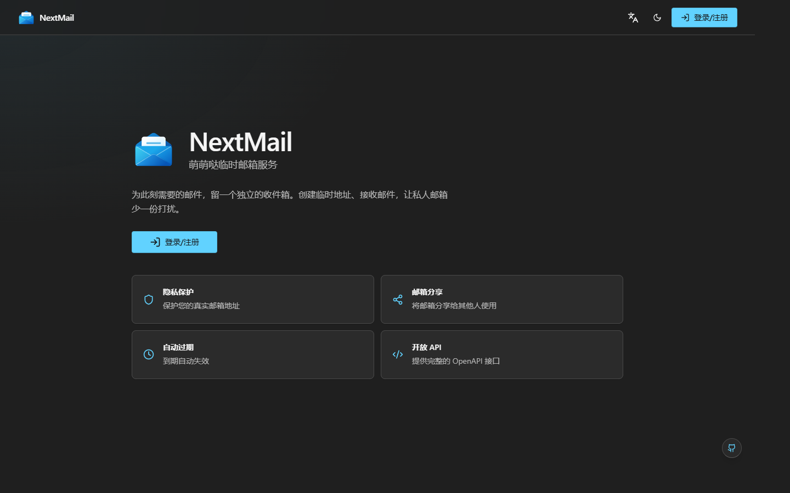

  
  <h1 align="center">NextMail</h1>

## 使用文档
**原 MoeMail 仓库完整文档**: [https://docs.moemail.app](https://docs.moemail.app)

当前仓库文档：[使用](docs/usage.md) | [开发](docs/develop.md) | [部署](docs/deploy.md) | [审查](docs/review.md)

## 预览

[]

## 核心特性改进

- **Cloudflare 全自动部署**：一个配置即可快速部署，开箱即用
- **简雅的 UI**：基于 WinUI3 Fluent 重构界面，并适配移动端
- **多域名管理**：优化针对多收件域名的功能，支持定向管理
- **性能优化**: 砍掉了 7M 超大字体并针对大陆进行优化
- **批量管理**：邮箱批量删除、邮件批量删除
- **自动化测试**: 补充编写大量测试文件
- **安全修复**：包含独立发现的安全漏洞修复和功能性改进

## 技术栈

- **框架**: [Next.js](https://nextjs.org/) (App Router)
- **平台**: [Cloudflare Workers](https://workers.cloudflare.com/)
- **数据库**: [Cloudflare D1](https://developers.cloudflare.com/d1/) (SQLite)
- **认证**: [NextAuth](https://authjs.dev/getting-started/installation?framework=Next.js)，支持 GitHub、Google 和用户名密码登录
- **样式**: [Tailwind CSS](https://tailwindcss.com/)
- **UI 组件**: 基于 [Radix UI](https://www.radix-ui.com/) 的自定义组件
- **邮件处理**: [Cloudflare Email Workers](https://developers.cloudflare.com/email-routing/)
- **类型安全**: [TypeScript](https://www.typescriptlang.org/)
- **ORM**: [Drizzle ORM](https://orm.drizzle.team/)
- **国际化**: [next-intl](https://next-intl-docs.vercel.app/) 支持多语言，当前仅对 中文/英文 进行适配

> 开发和部署统一使用被忽略的 `.env.deploy`，从 `.env.deploy.example` 复制后填写必填项即可。示例后半部分提供网站、Turnstile、Resend、Catch-all 和账号初始化等可选项。详见[部署说明](docs/deploy.md)。

## 鸣谢

- 原 MoeMail 仓库开发者：[beilunyang](https://github.com/beilunyang/moemail)
