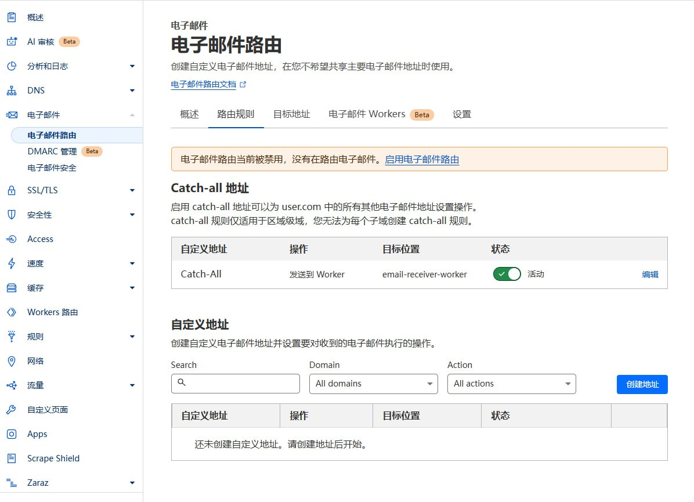
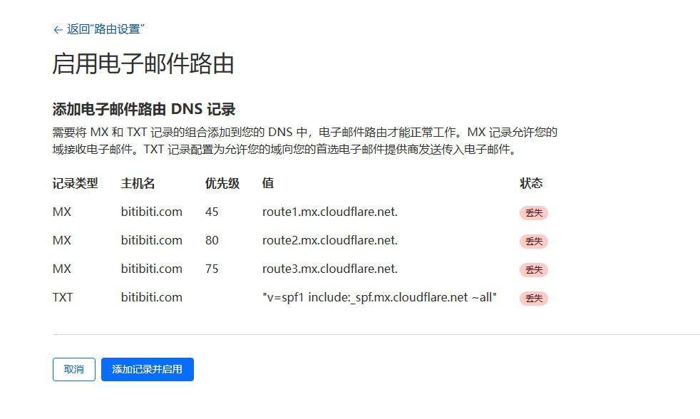
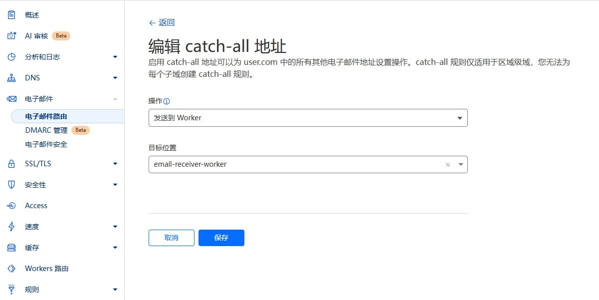

# NextMail 使用说明

## 邮箱域名配置

在 NextMail 个人中心页面，可以配置网站的邮箱域名，支持多域名配置，多个域名用逗号分隔。

### Cloudflare 邮件路由配置

为了使邮箱域名生效，还需要在 Cloudflare 控制台配置邮件路由，将收到的邮件转发给 Email Worker 处理。

1. 登录 [Cloudflare 控制台](https://dash.cloudflare.com/)
2. 选择您的域名
3. 点击左侧菜单的 "电子邮件" -> "电子邮件路由"
4. 如果显示 “电子邮件路由当前被禁用，没有在路由电子邮件”，请点击 "启用电子邮件路由"

5. 点击后，会提示你添加电子邮件路由 DNS 记录，点击 “添加记录并启用” 即可

6. 配置路由规则：
   - Catch-all 地址: 启用 "Catch-all"
   - 编辑 Catch-all 地址
    - 操作: 选择 "发送到 Worker"
    - 目标位置: 选择刚刚部署的 "email-receiver-worker"
    - 保存
      

### 注意事项
- 确保域名的 DNS 托管在 Cloudflare
- Email Worker 必须已经部署成功
- 如果 Catch-All 状态不可用(一直 loading)，请点击`路由规则`旁边的`目标地址`, 进去绑定一个邮箱

## 权限系统

本项目采用基于角色的权限控制系统（RBAC）。

### 角色配置

新用户默认角色由皇帝在个人中心的网站设置中配置：
- 公爵：新用户将获得临时邮箱、Webhook 配置权限以及 API Key 管理权限
- 骑士：新用户将获得临时邮箱和 Webhook 配置权限
- 平民：新用户无任何权限，需要等待皇帝册封为骑士或公爵

### 角色等级

系统包含四个角色等级：

1. **皇帝（Emperor）**
   - 网站所有者
   - 拥有所有权限
   - 每个站点只能有一个皇帝

2. **公爵（Duke）**
   - 超级用户
   - 可以使用临时邮箱功能
   - 可以配置 Webhook
   - 可以使用创建 API Key 调用 OpenAPI
   - 可以被皇帝贬为骑士或平民

3. **骑士（Knight）**
   - 高级用户
   - 可以使用临时邮箱功能
   - 可以配置 Webhook
   - 可以被皇帝贬为平民或册封为公爵

3. **平民（Civilian）**
   - 普通用户
   - 无任何权限
   - 可以被皇帝册封为骑士或者公爵

### 角色升级

1. **成为皇帝**
   - 登录希望作为网站所有者的账号，点击头像进入个人中心（`/{locale}/profile`）
   - 站点尚无皇帝时，个人中心会显示“初始化网站所有者”；点击“成为皇帝”，核对确认框中的账号后确认
   - 第一个已登录并成功确认的用户将成为皇帝；页面会重新加载并显示新角色及管理设置
   - 站点已有皇帝后，无法再提升其他用户为皇帝
   - 初始化接口同时支持 `GET` 和 `POST /api/roles/init-emperor`；两种请求都会尝试册封当前已登录用户。未登录返回 401，已有皇帝时返回 409。`HEAD` 不会执行初始化
   - 会话过期时需重新登录；若其他用户已抢先成为皇帝，会显示对应提示，不会更改当前账号的角色

2. **角色变更**
   - 皇帝可以在个人中心页面将其他用户设为公爵、骑士或平民

### 权限说明

- **邮箱管理**：创建和管理临时邮箱
- **Webhook 管理**：配置邮件通知的 Webhook
- **API Key 管理**：创建和管理 API 访问密钥
- **用户管理**：升降用户角色
- **系统设置**：管理系统全局设置

## 系统设置

系统设置存储在 Cloudflare KV 中，包括以下内容：

- `DEFAULT_ROLE`: 新注册用户默认角色，可选值为 `civilian`、`knight`、`duke`
- `EMAIL_DOMAINS`: 支持的邮箱域名，多个域名用逗号分隔
- `ADMIN_CONTACT`: 管理员联系方式
- `MAX_EMAILS`: 每个非皇帝用户可创建的最大活跃邮箱数量，默认值为 30；皇帝不受此限制
- `CATCHALL_EMAIL`: 按域名保存 Catch-all 地址、启用状态和停用后的显示设置
- `RESEND_CONFIG`: 按域名保存 Resend 启用状态和 API Key，仅皇帝可管理
- `EMAIL_ROLE_LIMITS`: 保存公爵和骑士的每日发件限额

**皇帝**角色可以在个人中心页面设置

## 发件功能

NextMail 支持使用临时邮箱发送邮件，基于 [Resend](https://resend.com/) 服务。

### 功能特性

- 📨 **临时邮箱发件**：可以使用创建的临时邮箱作为发件人发送邮件
- 🎯 **角色权限控制**：不同角色有不同的每日发件限制
- 💌 **支持 HTML**：支持发送富文本格式邮件

### 角色发件权限

| 角色 | 每日发件限制 | 说明 |
|------|-------------|------|
| 皇帝 (Emperor) | 无限制 | 网站管理员，无发件限制 |
| 公爵 (Duke) | 5封/天 | 默认每日可发送5封邮件 |
| 骑士 (Knight) | 2封/天 | 默认每日可发送2封邮件 |
| 平民 (Civilian) | 禁止发件 | 无发件权限 |

> 💡 **提示**：皇帝可以在个人中心的邮件服务配置中自定义公爵和骑士的每日发件限制。

### 配置发件服务

1. **获取 Resend API Key**
   - 访问 [Resend 官网](https://resend.com/) 注册账号
   - 在控制台中创建 API Key
   - 复制 API Key 供后续配置使用

2. **配置发件服务**
   - 皇帝角色登录 NextMail
   - 进入个人中心页面
   - 在"Resend 发件服务配置"部分：
     - 找到需要配置的接收域名，启用该域名的发件开关
     - 填入该域名的 Resend API Key；已有密钥留空可保留
     - 对其他需要发件的域名分别配置
     - 设置公爵和骑士的每日发件限制（可选）
   - 点击保存配置

3. **验证配置**
   - 配置保存后，有权限的用户在邮箱列表页面会看到"发送邮件"按钮
   - 点击按钮可以打开发件对话框进行测试

### 使用发件功能

1. **创建临时邮箱**
   - 在邮箱页面创建一个新的临时邮箱

2. **发送邮件**
   - 在邮箱列表中找到要使用的邮箱
   - 点击邮箱旁边的"发送邮件"按钮
   - 在弹出的对话框中填写：
     - 收件人邮箱地址
     - 邮件主题
     - 邮件内容（支持 HTML 格式）
   - 点击"发送"按钮

3. **查看发送记录**
   - 发送的邮件会自动保存到对应邮箱的消息列表中
   - 可以在邮箱详情页面查看所有发送和接收的邮件

### 注意事项

- 📋 **Resend 限制**：请注意 Resend 服务的发送限制和定价政策
- 🔐 **域名验证**：使用自定义域名发件需要在 Resend 中验证域名
- 🚫 **反垃圾邮件**：请遵守邮件发送规范，避免发送垃圾邮件
- 📊 **配额监控**：系统会自动统计每日发件数量，达到限额后将无法继续发送
- 🔄 **配额重置**：每日发件配额在每天 00:00 UTC 自动重置

## Webhook 集成

当收到新邮件时，系统会向用户配置并且已启用的 Webhook URL 发送 POST 请求。

### 请求头
```http
Content-Type: application/json
X-Webhook-Event: new_message
```

### 请求体
```json
{
  "emailId": "email-uuid",
  "messageId": "message-uuid",
  "fromAddress": "sender@example.com",
  "subject": "邮件主题",
  "content": "邮件文本内容",
  "html": "邮件HTML内容",
  "receivedAt": "2024-01-01T12:00:00.000Z",
  "toAddress": "your-email@example.com"
}
```

### 配置说明
1. 点击个人头像，进入个人中心
2. 在个人中心启用 Webhook
3. 设置接收通知的 URL
4. 点击测试按钮验证配置
5. 保存配置后即可接收新邮件通知

### 测试

项目提供了一个简单的测试服务器，可以通过如下命令运行：

```bash
npm run webhook-test-server
```

测试服务器会在本地启动 HTTP 服务器，监听 3001 端口（http://localhost:3001），解析收到的 Webhook 消息，打印邮件主题并返回 HTTP 200。

如果需要进行外网测试，先安装 Cloudflare Tunnel 的 `cloudflared` 可执行文件，再将服务暴露到外网：
```bash
cloudflared tunnel --url http://localhost:3001
```

### 注意事项
- Webhook 接口应在 10 秒内响应
- 测试按钮和邮件 Worker 的 Webhook 投递最多尝试 3 次；投递失败不会删除或拒绝已经保存的邮件

## OpenAPI

本项目提供了 OpenAPI 接口，支持通过 API Key 进行访问。API Key 可以在个人中心页面创建（需要是公爵或皇帝角色）。

### 使用 API Key

对 `/api/emails/*` 和 `/api/config` 请求，可在请求头中添加 API Key。Webhook、角色和 API Key 管理接口使用登录会话：
```http
X-API-Key: YOUR_API_KEY
```

### API 接口

#### 获取系统配置
```http
GET /api/config
```
返回响应：
```json
{
  "defaultRole": "civilian",
  "emailDomains": "example.com",
  "adminContact": "admin@example.com",
  "maxEmails": "30"
}
```
响应字段说明：
- `defaultRole`: 新用户默认角色，可选值：`civilian`（平民）、`knight`（骑士）、`duke`（公爵）
- `emailDomains`: 支持的邮箱域名，多个域名用逗号分隔
- `adminContact`: 管理员联系方式
- `maxEmails`: 每个非皇帝用户可创建的最大活跃邮箱数量，默认值为 30；皇帝不受此限制

已认证用户还会收到 `availableEmailDomains`，表示当前用户可创建邮箱的域名。皇帝请求该接口时，还会返回 `turnstile` 配置（`enabled`、`siteKey`、`secretKey`）和 `catchAll.domains`；后者按域名包含 `enabled`、`showAlways`、`mailboxName`。

#### 创建临时邮箱
```http
POST /api/emails/generate
Content-Type: application/json

{
  "name": "test",
  "expiryTime": 3600000,
  "domain": "example.com"
}
```
参数说明：
- `name`: 邮箱前缀，可选
- `expiryTime`: 有效期（毫秒），必填，允许值：3600000（1小时）、86400000（1天）、259200000（3天）、0（永久）
- `domain`: 邮箱域名，必填，从 `/api/config` 返回的 `availableEmailDomains` 中选择

返回响应：
```json
{
  "id": "email-uuid-123",
  "email": "test@example.com"
}
```
响应字段说明：
- `id`: 邮箱的唯一标识符
- `email`: 创建的邮箱地址

#### 获取邮箱列表
```http
GET /api/emails?cursor=xxx&domain=example.com
```
参数说明：
- `cursor`: 分页游标，可选
- `domain`: 域名筛选，可选；不传时返回全部域名

返回响应：
```json
{
  "emails": [
    {
      "id": "email-uuid-123",
      "address": "test@example.com",
      "createdAt": "2024-01-01T12:00:00.000Z",
      "expiresAt": "2024-01-02T12:00:00.000Z",
      "userId": "user-uuid-456"
    }
  ],
  "nextCursor": "encoded-cursor-string",
  "total": 5
}
```
响应字段说明：
- `emails`: 邮箱列表数组
- `nextCursor`: 下一页游标，用于分页请求
- `total`: 当前域名筛选结果的邮箱总数量，仅首次加载或刷新返回
- `emails[].isCatchAll`: 是否为 Catch-all 邮箱
- `emails[].unreadMessages` / `emails[].totalMessages`: 收件箱未读数与总数

#### 获取指定邮箱邮件列表
```http
GET /api/emails/{emailId}?cursor=xxx
```

默认返回收件邮件；传入 `type=sent` 可获取已发送邮件：`GET /api/emails/{emailId}?type=sent&cursor=xxx`。
参数说明：
- `emailId`: 邮箱的唯一标识符，必填
- `cursor`: 分页游标，可选

返回响应：
```json
{
  "messages": [
    {
      "id": "message-uuid-789",
      "from_address": "sender@example.com",
      "subject": "邮件主题",
      "received_at": 1704110400000
    }
  ],
  "nextCursor": "encoded-cursor-string",
  "total": 3
}
```
响应字段说明：
- `messages`: 邮件列表数组
- `nextCursor`: 下一页游标，用于分页请求
- `total`: 邮件总数量，首次加载、手动刷新及增量轮询均返回；后续普通分页保留已有总数
- `unread`: 收件列表的未读数量，首次加载、手动刷新及增量轮询均返回；客户端使用返回的总数更新统计，避免与邮箱列表刷新重复累计
- `latestCursor`: 增量查询游标；首次无 `cursor` 请求的响应用于初始化轮询，随后仅使用 `since` 响应推进检查点。普通分页响应中的值不能作为轮询检查点；手动刷新列表头部时也须保留已有检查点，以免遗漏排序在旧页中的延迟收件。使用 `since=latestCursor` 获取更新的邮件元数据
- `hasMore`: 增量结果是否还有下一页；为真时用返回的 `latestCursor` 继续请求

列表仅返回元数据及 `is_read`，正文请通过邮件详情接口获取。增量查询按数据库写入序号升序返回，即使邮件时间更早或随机 ID 更小，后提交的邮件也能被获取；普通分页仍按邮件时间及 ID 降序返回。游标是不透明值，客户端不应自行构造或解析。本人读取邮件详情会将收到的邮件标为已读，并返回操作后的 `total`、`unread` 统计；重复或跨会话读取按服务端统计更新，不会重复减少未读数。

#### 发送邮件

```http
POST /api/emails/{emailId}/send
Content-Type: application/json

{
  "to": "recipient@example.org",
  "subject": "邮件主题",
  "content": "<p>邮件正文</p>"
}
```

`to`、`subject` 和 `content` 均为必填字符串，`content` 作为 HTML 正文发送。邮箱必须属于当前用户、尚未过期，且所属域名已启用 Resend。角色权限和每日配额与网页登录发件一致。

皇帝从 Catch-all 邮箱发件时，可额外传入 `fromLocalPart` 修改发件前缀，域名固定为该邮箱域名。已注册的 Catch-all 通过邮箱 ID 识别，KV 地址尚未同步时仍可发送；只有未注册的旧配置才使用地址匹配。普通邮箱不能传入此参数。

成功返回 `success: true` 和 `message`；有每日配额的用户还会收到 `remainingEmails`。已发送内容可通过 `type=sent` 列表及邮件详情接口读取。

#### 删除邮箱
```http
DELETE /api/emails/{emailId}
```
参数说明：
- `emailId`: 邮箱的唯一标识符，必填

返回响应：
```json
{
  "success": true
}
```
响应字段说明：
- `success`: 删除操作是否成功

#### 获取单封邮件内容
```http
GET /api/emails/{emailId}/{messageId}
```
参数说明：
- `emailId`: 邮箱的唯一标识符，必填
- `messageId`: 邮件的唯一标识符，必填

返回响应：
```json
{
  "message": {
    "id": "message-uuid-789",
    "from_address": "sender@example.com",
    "subject": "邮件主题",
    "content": "邮件文本内容",
    "html": "<p>邮件HTML内容</p>",
    "received_at": 1704110400000
  }
}
```
响应字段说明：
- `message`: 邮件详细信息对象
- `id`: 邮件的唯一标识符
- `from_address`: 发件人邮箱地址
- `subject`: 邮件主题
- `content`: 邮件纯文本内容
- `html`: 邮件HTML内容
- `received_at`: 接收时间（时间戳）

同一路径支持 `DELETE`，用于删除指定邮箱中的单封邮件：

```http
DELETE /api/emails/{emailId}/{messageId}
```

删除收件后返回 `success` 及操作后的收件箱 `total`、`unread`，客户端应直接应用这些统计，避免跨会话已读状态变化导致重复扣减。删除发件仅返回 `success`。

#### 创建邮箱分享链接
```http
POST /api/emails/{emailId}/share
Content-Type: application/json

{
  "expiresIn": 86400000
}
```
参数说明：
- `emailId`: 邮箱的唯一标识符，必填
- `expiresIn`: 分享链接有效期（毫秒），0 表示永久有效，可选

返回响应：
```json
{
  "id": "share-uuid-123",
  "emailId": "email-uuid-123",
  "token": "abc123def456",
  "expiresAt": "2024-01-02T12:00:00.000Z",
  "createdAt": "2024-01-01T12:00:00.000Z"
}
```
响应字段说明：
- `id`: 分享记录的唯一标识符
- `emailId`: 关联的邮箱 ID
- `token`: 分享链接的访问令牌
- `expiresAt`: 分享链接过期时间，null 表示永久有效
- `createdAt`: 创建时间

分享链接访问地址：`https://app.example.com/shared/{token}`

#### 获取邮箱的所有分享链接
```http
GET /api/emails/{emailId}/share
```
参数说明：
- `emailId`: 邮箱的唯一标识符，必填

返回响应：
```json
{
  "shares": [
    {
      "id": "share-uuid-123",
      "emailId": "email-uuid-123",
      "token": "abc123def456",
      "expiresAt": "2024-01-02T12:00:00.000Z",
      "createdAt": "2024-01-01T12:00:00.000Z"
    }
  ],
  "total": 1
}
```
响应字段说明：
- `shares`: 分享链接列表数组
- `total`: 分享链接总数

#### 删除邮箱分享链接
```http
DELETE /api/emails/{emailId}/share/{shareId}
```
参数说明：
- `emailId`: 邮箱的唯一标识符，必填
- `shareId`: 分享记录的唯一标识符，必填

返回响应：
```json
{
  "success": true
}
```
响应字段说明：
- `success`: 删除操作是否成功

#### 创建邮件分享链接
```http
POST /api/emails/{emailId}/messages/{messageId}/share
Content-Type: application/json

{
  "expiresIn": 86400000
}
```
参数说明：
- `emailId`: 邮箱的唯一标识符，必填
- `messageId`: 邮件的唯一标识符，必填
- `expiresIn`: 分享链接有效期（毫秒），0 表示永久有效，可选

返回响应：
```json
{
  "id": "share-uuid-456",
  "messageId": "message-uuid-789",
  "token": "xyz789ghi012",
  "expiresAt": "2024-01-02T12:00:00.000Z",
  "createdAt": "2024-01-01T12:00:00.000Z"
}
```
响应字段说明：
- `id`: 分享记录的唯一标识符
- `messageId`: 关联的邮件 ID
- `token`: 分享链接的访问令牌
- `expiresAt`: 分享链接过期时间，null 表示永久有效
- `createdAt`: 创建时间

分享链接访问地址：`https://app.example.com/shared/message/{token}`

邮件分享不会延长所属邮箱的有效期。通过 `GET /api/shared/message/{token}` 读取时，分享或邮箱已到期（含恰好到期）会返回 HTTP 410，响应不含邮件正文；分享已撤销或相关记录已删除时返回 HTTP 404。

#### 获取邮件的所有分享链接
```http
GET /api/emails/{emailId}/messages/{messageId}/share
```
参数说明：
- `emailId`: 邮箱的唯一标识符，必填
- `messageId`: 邮件的唯一标识符，必填

返回响应：
```json
{
  "shares": [
    {
      "id": "share-uuid-456",
      "messageId": "message-uuid-789",
      "token": "xyz789ghi012",
      "expiresAt": "2024-01-02T12:00:00.000Z",
      "createdAt": "2024-01-01T12:00:00.000Z"
    }
  ],
  "total": 1
}
```
响应字段说明：
- `shares`: 分享链接列表数组
- `total`: 分享链接总数

#### 删除邮件分享链接
```http
DELETE /api/emails/{emailId}/messages/{messageId}/share/{shareId}
```
参数说明：
- `emailId`: 邮箱的唯一标识符，必填
- `messageId`: 邮件的唯一标识符，必填
- `shareId`: 分享记录的唯一标识符，必填

返回响应：
```json
{
  "success": true
}
```
响应字段说明：
- `success`: 删除操作是否成功

### 使用示例

以下 `https://app.example.com` 需替换为当前站点的自定义域名或 `workers.dev` 地址；邮箱接收域名另行配置。

使用 curl 创建临时邮箱：
```bash
curl -X POST https://app.example.com/api/emails/generate \
  -H "X-API-Key: YOUR_API_KEY" \
  -H "Content-Type: application/json" \
  -d '{
    "name": "test",
    "expiryTime": 3600000,
    "domain": "example.com"
  }'
```

使用 JavaScript 获取邮件列表：
```javascript
const res = await fetch('https://app.example.com/api/emails/your-email-id', {
  headers: {
    'X-API-Key': 'YOUR_API_KEY'
  }
});
const data = await res.json();
```

使用 curl 创建邮箱分享链接：
```bash
curl -X POST https://app.example.com/api/emails/your-email-id/share \
  -H "X-API-Key: YOUR_API_KEY" \
  -H "Content-Type: application/json" \
  -d '{
    "expiresIn": 86400000
  }'
```

使用 JavaScript 创建邮件分享链接：
```javascript
const res = await fetch('https://app.example.com/api/emails/your-email-id/messages/your-message-id/share', {
  method: 'POST',
  headers: {
    'X-API-Key': 'YOUR_API_KEY',
    'Content-Type': 'application/json'
  },
  body: JSON.stringify({
    expiresIn: 0  // 永久有效
  })
});
const data = await res.json();
console.log('分享链接:', `https://app.example.com/shared/message/${data.token}`);
```

邮箱域名必须是运营者配置了 Email Routing 的接收域名。未设置 `EMAIL_DOMAINS` 时，`/api/config` 返回空字符串，创建邮箱返回 HTTP 503。

## 多域名邮箱管理

皇帝可在网站配置中分别为每个接收域名启用 Catch-all、设置邮箱前缀，并决定停用后是否继续显示该邮箱。系统创建归皇帝所有且永不过期的 Catch-all 邮箱；修改前缀会保留邮箱及已有邮件。已被其他邮箱占用的地址不能用于该配置。Catch-all 邮箱在列表置顶，需通过网站设置管理，不能从邮箱列表直接删除。

未知地址的邮件仅在所属域名已配置且启用 Catch-all 时进入该邮箱；系统不会为每个未知地址新建邮箱。已存在但过期的收件地址仍按过期策略丢弃。邮件与 Webhook 保留实际收件地址，发件人优先显示邮件正文头部的 From 地址，缺失时使用 SMTP 信封地址。

Catch-all 重命名保留邮箱 ID 及原邮件，收件通过数据库中的固定关联定位。并发首次保存会复用先注册的邮箱，后续前缀变更仍保留已有邮件。KV 保存失败时，可直接重试相同配置，系统会复用已创建的邮箱。

Catch-all 列表标识、置顶及删除保护也通过注册的邮箱 ID 判断；配置中的地址尚未同步时，仍不能直接删除该邮箱及原邮件。

Resend 发件服务支持按域名分别启停和保存 API Key。留空已有密钥输入框会保留当前密钥。旧版全局配置在首次保存域名配置前继续兼容；已移除的域名配置显示失效提示，下次保存时清除。皇帝使用 Catch-all 邮箱发件时可修改发件地址前缀，域名固定为当前邮箱的域名；普通邮箱使用自身地址。每日发送限制继续按用户统计。

皇帝可在角色管理中设置其他用户允许创建邮箱的域名。未单独配置的用户继承当前全部站点域名；明确取消全部域名后，该用户不能创建新邮箱。皇帝始终可使用全部站点域名。该设置限制新建邮箱，已有邮箱保留。

邮箱列表支持按域名筛选，并显示收件箱的未读数与总数。打开本人收到的邮件后自动标为已读，公开分享页不会修改所有者的已读状态。当前邮箱每 30 秒从上次游标增量获取新邮件；页面隐藏时跳过轮询，重新显示后继续。手动刷新会更新统计及首屏邮件状态；已加载旧页中的其他会话删除或已读变化可能仍保留缓存，重新加载页面可清除旧页缓存。
